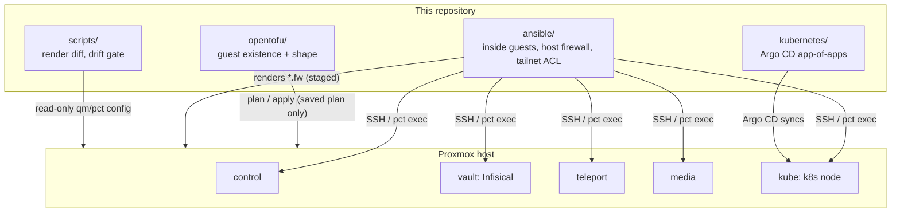

# homelab-as-code

Infrastructure as code for a single-node Proxmox homelab: OpenTofu for the
guests, Ansible for what runs inside them and for the host firewall, and Argo
CD for the Kubernetes node. Every change is rendered and reviewed before it
can be applied, and a drift gate reports whether the live machine still
matches the repository.

This is the public copy of a private repository that runs one real home
setup. Hostnames are generic roles, addresses are RFC 5737 documentation
ranges, and secrets, state and personal services have been removed. The roles,
scripts and safety rails come from that repository; the example inventory and
some of the offline tests were written for this copy.

## What it does



| Role | Kind | Zone | Runs |
|---|---|---|---|
| `control` | VM 100 | control | Ansible, kubectl, the OpenTofu client |
| `vault` | VM 101 | secrets | Infisical behind a Caddy TLS front; outbound traffic dropped |
| `media` | VM 112 | home | household media services |
| `teleport` | CT 115 | access | Teleport access plane; also the CA for vault's TLS cert |
| `kube` | VM 130 | cluster | single-node kubeadm + Cilium; ntfy, a headless browser API, node metrics, static previews |
| `gateway` | not built | dmz | future public reverse proxy; all its rules ship disabled |
| `monitor` | Raspberry Pi | monitor | uptime probes; not managed by Ansible |

More detail: [docs/architecture.md](docs/architecture.md).

## Why it is built this way

- **One owner per layer.** OpenTofu decides that a guest exists and how big it
  is; Ansible decides what runs in it; Argo CD decides what runs on the
  cluster. Nothing else changes those layers.
- **Data, not hand-written rules.** Every allowed network flow is one line in
  `ansible/inventory/host_vars/<guest>.yml`. Templates turn that into Proxmox
  firewall files; the rendered files are committed as reviewed baselines, so
  a change to a rule shows up as a diff.
- **Dry runs that can fail.** `ansible-playbook --check` cannot see guest
  hardware (the Proxmox modules do not support check mode), so
  `scripts/check-guest-config.sh` reads live `qm config` / `pct config` and
  compares declared fields. `scripts/drift-check.sh` combines it with the
  render diff and returns one of three verdicts: PASSED, DRIFT (named host
  and field) or ERROR. An unreachable host is an ERROR, never a pass.
- **Staged by default.** The firewall render, the Caddy TLS deploy and the
  Tailscale ACL push are all gated behind variables that default to off. The
  ACL role has no code path to the Tailscale API at all.
- **Secrets stay out of git.** OpenTofu state and plans are encrypted with a
  key that only unwraps when a YubiKey is present. Kubernetes reads secrets
  through External Secrets with one Infisical identity per namespace.

## Layout

```
ansible/       site.yml, playbooks/, roles/, example inventory (zones, host_vars firewall data)
opentofu/      Proxmox guests (bpg/proxmox), encrypted state, `fleet` wrapper, offline smoke tests
kubernetes/    Argo CD bootstrap, apps/, infra/ (namespaces, netpol, ESO, Cilium), workloads/
scripts/       drift gate, guest-config comparator, render diff, tests, libvirt clone helpers
docs/          architecture overview
```

## How to run it

Requirements: Python 3.12, `ansible-core` + `ansible-lint` + `yamllint`,
OpenTofu >= 1.10, `age`, `shellcheck`. [Task](https://taskfile.dev) is
optional; every task is a plain command in `Taskfile.yml`.

```bash
ansible-galaxy collection install -r ansible/requirements.yml

task lint            # yamllint, ansible-lint, check_mode guard, shellcheck
task syntax-check    # every playbook
task renders         # render firewall / Caddy / ACL and diff against baselines
task test            # comparator tests, Argo tree check, OpenTofu smoke + controls
```

Against a real host (edit the inventory, `opentofu/terraform.tfvars` and the
`example.com` names first):

```bash
PROXMOX_API_TOKEN_ID=... PROXMOX_API_TOKEN_SECRET=... ./scripts/drift-check.sh   # read-only
opentofu/scripts/fleet plan && opentofu/scripts/fleet apply                       # saved plan only
task apply CONFIRM=apply-live                                                     # site.yml, gated
kubectl apply -f kubernetes/bootstrap/root.yaml                                   # once; Argo takes over
```

Inject the Proxmox token from a secrets manager for that one command rather
than exporting it in your shell.

## Tests

CI (`.github/workflows/ci.yml`) runs on every push:

- **Ansible:** `yamllint`, `ansible-lint` (moderate profile), `--syntax-check`
  on every playbook, the `check_mode: false` guard, and the render diff.
- **Comparator:** `scripts/tests/test-check-guest-config.sh` feeds canned
  `qm`/`pct` output through a stubbed `ssh` and requires PASS, DRIFT for a
  changed field, a stray guest and a missing guest, and ERROR when SSH fails
  or returns nothing.
- **OpenTofu:** `fmt -check`, `validate`, then `fleet-smoke.sh`, which runs
  the real `fleet` wrapper in a pty against a fake Proxmox API replaying
  recorded answers, and `fleet-smoke-controls.sh`, which breaks one thing at a
  time and requires the smoke test to fail for that reason (8 controls).
- **Kubernetes:** `kubeconform -strict` with CRD schemas for Argo CD, Cilium
  and External Secrets, and a check that every Argo Application points at a
  real directory owned by exactly one Application.
- **Shell:** `shellcheck` on every script.

## Honest limits

- It describes **one** home setup: one Proxmox node, one Kubernetes node, no
  high availability. It is not a reusable module or a product.
- The inventory here is an example. Applying it unchanged to real hardware
  would not work; names, addresses and vmids must be replaced.
- `roles/proxmox_guest` and `roles/host_config` are partly stubs (marked
  `TODO`): guest creation moved to OpenTofu, and per-host configuration is not
  automated yet.
- The firewall and Caddy roles render to a staging directory. Applying the
  rendered firewall to `/etc/pve/firewall` is a manual, snapshot-first step,
  not something this repo does.
- OpenTofu manages one imported container and an optional pilot. The other
  guests are still described only on the Ansible side.
- CI proves the code parses, lints, renders and passes offline tests against
  stubs. It does not touch a real hypervisor.

## License

MIT, see [LICENSE](LICENSE).
