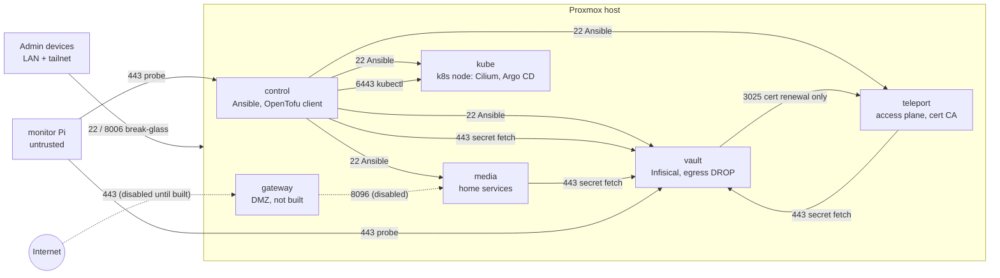

# Architecture

One Proxmox VE host runs every guest. The design splits responsibility by
layer, and each layer has exactly one tool that is allowed to change it.

| Layer | Owner | Where |
|---|---|---|
| Guest existence and shape (vmid, CPU, RAM, disks, NICs, pool) | OpenTofu | `opentofu/` |
| What runs inside a guest; host firewall; tailnet ACL | Ansible | `ansible/` |
| Workloads on the Kubernetes node | Argo CD (GitOps) | `kubernetes/` |
| Drift detection across all of the above | shell + Python gates | `scripts/` |

## Network

- **Default deny, east-west and intra-zone.** Every guest has
  `policy_in: DROP`; each allowed flow is one line of data in
  `ansible/inventory/host_vars/<guest>.yml`. `vault` also drops all egress
  except the single cert-renewal flow to Teleport.
- **Two break-glass paths that do not depend on the tailnet:** LAN SSH from
  two reserved admin addresses, and the hypervisor's :8006 console.
- **Tailnet as an admin door, not a service mesh.** The Tailscale ACL grants
  admin devices SSH/HTTPS/console and the monitor exactly one probe; the
  validator in `roles/tailscale_acl` fails if anything broader appears.
- **Inside the Kubernetes node** the host firewall is only the outer ring:
  namespaces are default-deny with Cilium policies, and ingress arrives only
  through the Tailscale operator.

## Change flow

1. Edit data (inventory, host_vars, `main.tf`, manifests). Never edit rendered
   output.
2. Render and review: `scripts/check-renders.sh` shows the firewall, Caddy and
   ACL diff against committed baselines; `scripts/fleet plan` shows the
   OpenTofu plan.
3. Apply deliberately: firewall and Caddy deploys are gated behind variables
   that default to off; `fleet apply` only applies a saved plan; Argo CD syncs
   merged manifests.
4. Measure drift: `scripts/drift-check.sh` returns PASSED, DRIFT (a named
   host and field) or ERROR (could not measure). An unreachable host is never
   reported as clean.

## Secrets

No secret values are in this repository. The Proxmox API token and the
OpenTofu state key are age-encrypted to a hardware key and decrypted for one
command at a time. Kubernetes workloads read from Infisical through External
Secrets, one machine identity per namespace. Ansible reads the Proxmox token
from the environment, injected by the secrets manager for a single run.
